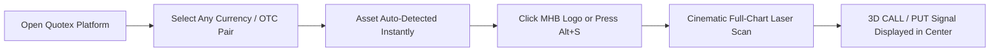

# ⚡ SignalScan — Developed by @PARVEZ_MHB

<p align="center">
  
</p>

<p align="center">
  <b>Ultra-Minimal Cinematic 1-Minute Chart Scanner & Algorithmic Directional Indicator</b><br>
  <i>Built for Binary Options, Forex & Crypto Traders (Optimized for Quotex OTC)</i>
</p>

<p align="center">
  
  
  
  
</p>

---

## 📖 Overview

**SignalScan** is an ultra-high performance, professional Google Chrome extension (Manifest V3) that inspects and analyzes live trading charts in real time (e.g. on Quotex) to generate institutional-grade 1-minute directional candlestick signals (**CALL / PUT**).

Unlike random or lagging signal bots, **SignalScan** computes a mathematical consensus across **6 core technical indicators** and **live price action patterns**, delivering high-probability predictions with zero chart obstruction.

---

## ✨ Key Features

- 🎯 **Strictly Manual Scan (No Auto-Scan):** Never triggers unwanted scans. A scan executes only when you click the floating **MHB logo** or press `Alt + S`.
- 🔍 **Real-Time Auto Asset Detection:** Instantly auto-detects whichever trading pair is active on Quotex (`USD/INR (OTC)`, `USD/EGP (OTC)`, `AUD/NZD (OTC)`, `NZD/CAD (OTC)`, Crypto, or OTC Stocks) directly from the live DOM without manual selection.
- 🎬 **Cinematic Holographic Laser Scanner:** Sweeps a 4-tier volumetric neon laser beam with horizontal anamorphic lens streaks across the broker's chart.
- 🏹 **Dead-Center 3D Signal Projection:** Projects a glowing 3D obsidian disc with an arrow, confidence percentage, and live second-by-second countdown **right in the dead-center of the display chart**—completely clear of Quotex's Buy/Sell buttons.
- ⚙️ **Mini Settings Quick-Launch Button:** A subtle gear icon (`⚙`) attached beside the MHB launcher gives one-click access to the settings panel (thresholds, audio, themes).
- 🪟 **Freely Draggable Anywhere:** Both the floating launcher widget and the popup card can be dragged freely to any coordinates across your screen.
- 🛡️ **Zero CSP Network Proxy:** Uses the background service worker proxy to fetch live M1 candlestick feeds across browser Content Security Policy (CSP) barriers without console errors.

---

## 🧠 Scoring Consensus Engine

SignalScan analyzes 100 historical 1-minute candles and weighs multiple independent technical indicators to formulate a single directional score:

| Indicator | Configuration | Weight | Function & Purpose |
| :--- | :--- | :---: | :--- |
| **EMA Cross** | 9 EMA / 21 EMA | **18%** | Primary trend direction, exponential momentum |
| **RSI** | 14 Period (Wilder's Smoothing) | **16%** | Overbought (>70) & Oversold (<30) reversal detection |
| **MACD** | 12, 26, 9 Fast/Slow/Signal | **16%** | Convergence/divergence acceleration & histogram crosses |
| **Bollinger Bands** | 20 Period, 2.0 Std Dev | **14%** | Volatility squeeze and statistical band penetration |
| **Stochastic** | 14, 3, 3 Fast/Slow %K %D | **12%** | Fast turning-point triggers within intraday trend |
| **Price Action** | Pin bar, Engulfing, Hammer | **14%** | Candlestick rejection verification at key support/resistance |
| **Trend Consensus** | Multi-timeframe slope | **10%** | Anti-whipsaw filter against counter-trend false breakouts |

> **Note:** A signal will only be confirmed as **CALL (UP)** or **PUT (DOWN)** if the cumulative confidence score surpasses the user-defined threshold (default: **75%**).

---

## 🚀 Installation Guide

### 1. Clone or Download the Repository:
```bash
git clone https://github.com/parvezrepository/SignalScan-Quotex-extensions.git
cd SignalScan-Quotex-extensions
```
*(Or click **Code -> Download ZIP** on GitHub and extract the folder).*

### 2. Build the Production Bundle (Optional):
The repository already includes the pre-compiled `content/bundle.js`. If you wish to rebuild after making changes:
```bash
npm install
node build.js
```
*(Creates an optimized, self-contained single-file bundle in seconds).*

### 3. Load into Google Chrome:
1. Open Google Chrome and navigate to: `chrome://extensions/`
2. Enable **Developer mode** toggle in the top-right corner.
3. Click the **Load unpacked** button in the top-left corner.
4. Select the project root directory (`QX SCAN` / `SignalScan-Quotex-extensions`).
5. Done! **SignalScan - Developed by @PARVEZ_MHB** will appear in your extensions list.

---

## 🎮 How to Use



1. **Open Quotex:** Navigate to `https://market-qx.info/en/trade` or your preferred broker platform.
2. **Select Asset:** Switch to any currency pair or OTC asset (e.g., `USD/INR (OTC)` or `USD/EGP (OTC)`). The extension automatically detects and aligns with the selected market.
3. **Click the MHB Logo:** Click the floating circular **MHB logo** button (or press `Alt + S` on your keyboard).
4. **View Signal:** The holographic laser will scan the display chart, lock onto the current candlestick, and project a 3D **CALL ▲** or **PUT ▼** confirmation badge right in the center of your chart.
5. **Adjust Settings:** Click the mini gear icon (`⚙`) attached to the MHB logo to adjust confidence threshold, WebAudio cues, or theme colors.

---

## ⌨️ Keyboard Shortcuts

| Shortcut | Description |
| :--- | :--- |
| **`Alt + S`** | Instantly trigger market scan on active tab |

---

## 📁 Directory Structure

```
QX SCAN/
├── background/
│   └── service-worker.js      # Background fetch proxy & lifecycle manager
├── content/
│   ├── animation.js           # 60fps mini-card canvas candlestick & radar animation
│   ├── bundle.js              # Production-compiled zero-latency IIFE bundle
│   ├── chart-scanner.js       # Full display chart holographic laser & 3D arrow engine
│   ├── content.js             # Master content controller & live DOM asset watcher
│   ├── styles.css             # Cyberpunk glassmorphism Shadow DOM styles
│   └── ui.js                  # MHB launcher, mini settings & draggable UI widget
├── engine/
│   ├── indicators.js          # Pure mathematical EMA, RSI, MACD, Bollinger, Stochastic
│   ├── patterns.js            # Real-time candlestick pattern recognition algorithms
│   └── scorer.js              # Weighted multi-indicator scoring consensus engine
├── icons/
│   ├── icon16.png             # Chrome toolbar icon (MHB)
│   ├── icon32.png             # Chrome window icon (MHB)
│   ├── icon48.png             # Extension management icon (MHB)
│   ├── icon128.png            # Chrome Web Store high-resolution icon (MHB)
│   └── mhb-logo.jpg           # Original MHB brand logo asset
├── providers/
│   ├── binance.js             # Binance live crypto kline WebSocket provider
│   ├── market.js              # Unified market data routing engine
│   ├── quotex-api.js          # Quotex live OTC M1 candlestick feed
│   └── twelvedata.js          # TwelveData forex fallback provider
├── tests/
│   └── indicators.test.js     # Automated mathematical unit test suite (6/6 Passing)
├── utils/
│   ├── audio.js               # Synthesized WebAudio lock & reveal sound effects
│   ├── format.js              # Currency validation & high-precision DOM extractors
│   └── storage.js             # Chrome sync & local storage persistence handler
├── build.js                   # ESBuild ultra-fast production packager
├── manifest.json              # Chrome Extension Manifest V3 configuration
├── package.json               # Project metadata & npm scripts
└── README.md                  # Comprehensive English documentation & installation guide
```

---

## 🧪 Unit Testing

To verify the mathematical accuracy of all technical indicator calculations, run the built-in test suite:
```bash
npm test
```
```
🧪 Starting SignalScan Technical Indicator Tests...

  ✓ EMA (Exponential Moving Average) verified against exact math
  ✓ RSI (Relative Strength Index) Wilder smoothing verified
  ✓ MACD (12, 26, 9) convergence and histogram verified
  ✓ Bollinger Bands (20, 2) upper/lower/width verified
  ✓ Stochastic (14, 3, 3) oscillator verified
  ✓ Noise filter and directional voting engine verified

✨ ALL TESTS PASSED SUCCESSFULLY! (6/6)
```

---

## 👨‍💻 Developer & Credits

- **Developer:** [@PARVEZ_MHB](https://github.com/PARVEZ_MHB)
- **Repository:** [SignalScan-Quotex-extensions](https://github.com/parvezrepository/SignalScan-Quotex-extensions)
- **Project:** SignalScan (MHB Edition)
- **Architecture:** Google Chrome Extension (Manifest V3)

---

## ⚠️ Disclaimer

*This software is created strictly for educational, analytical, and technical research purposes. Financial trading, including binary options and forex, carries significant capital risk. Past algorithmic performance does not guarantee future results. Always trade responsibly and manage your risk.*
