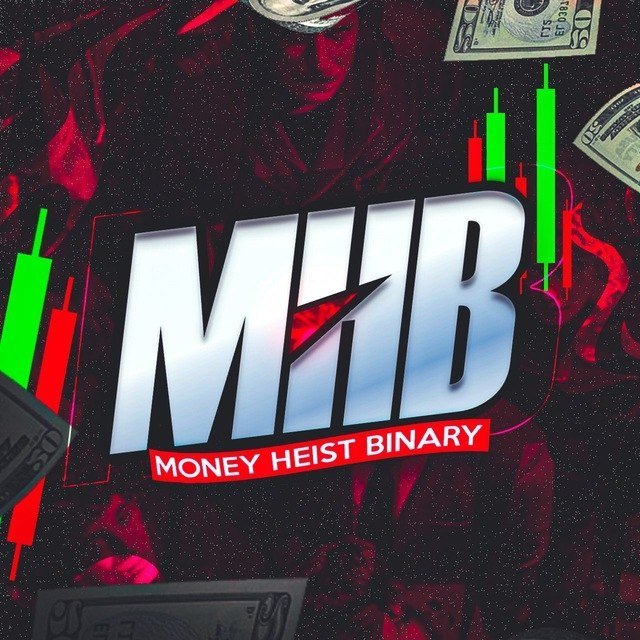
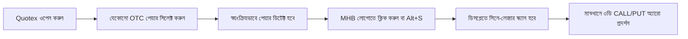

# ⚡ SignalScan — Developed by @PARVEZ_MHB

<p align="center">
  
</p>

<p align="center">
  <b>Ultra-Minimal Cinematic 1-Minute Chart Scanner & Algorithmic Directional Indicator</b><br>
  <i>Built for Binary Options, Forex & Crypto Traders (Optimized for Quotex OTC)</i>
</p>

<p align="center">
  
  
  
  
</p>

---

## 📖 সারসংক্ষেপ (Overview)

**SignalScan** হলো একটি উচ্চ-ক্ষমতাসম্পন্ন এবং প্রফেশনাল গুগল ক্রোম এক্সটেনশন (Manifest V3), যা ব্রাউজারের লাইভ ট্রেডিং চার্ট (যেমনঃ Quotex) বিশ্লেষণ করে ১ মিনিটের ক্যান্ডেলস্টিকের জন্য হাই-প্রোবাবিলিটি ডিরেকশনাল সিগন্যাল (CALL / PUT) তৈরি করে।

এটি কোনো এলোমেলো সিগন্যাল দেয় না; বরং ৬টি শক্তিশালী টেকনিক্যাল ইন্ডিকেটর এবং প্রাইস অ্যাকশন অ্যালগরিদমের কনসেনসাস (Consensus) নিয়ে রিয়েল-টাইম কনফার্মেশন প্রজেক্ট করে।

---

## ✨ প্রধান বৈশিষ্ট্যসমূহ (Key Features)

- 🎯 **Strictly Manual Scan (নো অটো-স্ক্যান):** এক্সটেনশন নিজে নিজে কখনো স্ক্যান করবে না। আপনি যখন স্ক্রিনের **MHB লোগোতে** ক্লিক করবেন বা `Alt+S` চাপবেন, কেবল তখনই স্ক্যান রান হবে।
- 🔍 **রিয়েল-টাইম অটো অ্যাসেট ডিটেকশন:** Quotex-এ আপনি যে অ্যাসেটেই সুইচ করুন না কেন (`USD/INR (OTC)`, `USD/EGP (OTC)`, `AUD/NZD (OTC)`, `NZD/CAD (OTC)`, ক্রিপ্টো বা স্টক)—এক্সটেনশন স্বয়ংক্রিয়ভাবে তা রাইট অর্ডার প্যানেল থেকে ডিটেক্ট করে নেয়। কোনো ম্যানুয়াল সিলেক্ট করার প্রয়োজন নেই।
- 🎬 **হলিউড-গ্রেড সিনে-লেজার স্ক্যানার:** চার্টের ওপর দিয়ে অ্যানামরফিক অনুভূমিক ফ্লেয়ারসহ ভলিউমেট্রিক নিয়ন লেজার সুইপ করে এবং লাইভ ক্যান্ডেল লক করে।
- 🏹 **ডিসপ্লের মাঝখানে ৩ডি কনফার্মেশন অ্যারো:** সিগন্যাল লক হওয়ার পর চার্টের কোনো বাটন না ঢেকে **ডিসপ্লের ঠিক মাঝখানে** বিশাল ৩ডি গ্লোয়িং অ্যারো, কনফার্মেশন পার্সেন্টেজ ও লাইভ কাউন্টডাউন ভেসে ওঠে।
- ⚙️ **মিনি সেটিংস গিয়ার বাটন:** MHB লোগোর পাশে রয়েছে একটি ছোট গিয়ার বাটন (`⚙`)। এখানে ক্লিক করলে সরাসরি সেটিংস প্যানেল স্লাইড করে ওপেন হবে।
- 🪟 **সম্পূর্ণ ফ্রিলি ড্র্যাগেবল (Draggable Widget):** লোগো আইকন এবং পপআপ কার্ডটি স্ক্রিনের যেকোনো জায়গায় টেনে নিয়ে রাখা যায়।
- 🛡️ **Zero CSP Error (ব্যাকগ্রাউন্ড প্রক্সি):** ব্রাউজারের কোনো Content Security Policy (CSP) বাধা ছাড়াই ব্যাকগ্রাউন্ড সার্ভিস ওয়ার্কারের মাধ্যমে লাইভ ক্যান্ডেল ডেটা ফেচ করে।

---

## 🧠 অ্যালগরিদম কনসেনসাস ইঞ্জিন (Scoring Engine)

এক্সটেনশনটি নিম্নলিখিত ইন্ডিকেটরগুলোর রিয়েল-টাইম গাণিতিক হিসেব করে সিগন্যাল তৈরি করে:

| Indicator | Configuration | Weight | Purpose |
| :--- | :--- | :---: | :--- |
| **EMA Cross** | 9 EMA / 21 EMA | **18%** | ট্রেন্ড ডিরেকশন ও মোমেন্টাম ডিটেকশন |
| **RSI** | 14 Period (Wilder's Smoothing) | **16%** | ওভারবট (>70) ও ওভারসোল্ড (<30) রিভার্সাল |
| **MACD** | 12, 26, 9 Fast/Slow/Signal | **16%** | হিস্টোগ্রাম ডাইভারজেন্স ও সিগন্যাল ক্রস |
| **Bollinger Bands** | 20 Period, 2.0 Std Dev | **14%** | ব্যান্ড পেনিট্রেশন ও ভলাটিলিটি স্কুইজ |
| **Stochastic** | 14, 3, 3 Fast/Slow %K %D | **12%** | ইন-ডিকেড মোমেন্টাম টার্নিং পয়েন্ট |
| **Price Action** | Pin bar, Engulfing, Hammer | **14%** | ক্যান্ডেলস্টিক প্যাটার্ন কনফার্মেশন |
| **Trend Consensus** | Multi-timeframe slope | **10%** | ট্রেন্ডের বিরুদ্ধে ফলস সিগন্যাল ফিল্টার |

> **নোট:** কনফিডেন্স স্কোর নির্ধারিত থ্রেশহোল্ড (ডিফল্ট: ৭৫%) পার করলেই কেবল **CALL (UP)** বা **PUT (DOWN)** সিগন্যাল লক হয়।

---

## 🚀 ইনস্টলেশন গাইড (How to Install)

### ১. রিপোজিটরি ক্লোন বা ডাউনলোড করুন:
```bash
git clone https://github.com/your-username/signalscan.git
cd signalscan
```
*(অথবা GitHub থেকে **Code -> Download ZIP** করে আনজিপ করুন)*

### ২. প্রোডাকশন বান্ডেল তৈরি করুন:
প্রজেক্টে Node.js ইনস্টল করা থাকলে ডিপেন্ডেন্সি ইনস্টল করে বিল্ড রান করুন:
```bash
npm install
node build.js
```
*(`content/bundle.js` স্বয়ংক্রিয়ভাবে অপ্টিমাইজড ও রেডি হয়ে যাবে)*

### ৩. গুগোল ক্রোমে এক্সটেনশন লোড করুন:
1. গুগল ক্রোম ব্রাউজার খুলে অ্যাড্রেস বারে যান: `chrome://extensions/`
2. ওপরের ডানদিকের **Developer mode** টগলটি চালু করুন।
3. ওপরের বামদিকের **Load unpacked** বাটনে ক্লিক করুন।
4. এই প্রজেক্টের রুট ফোল্ডারটি (`QX SCAN`) সিলেক্ট করুন।
5. ব্যস! **SignalScan - Developed by @PARVEZ_MHB** এক্সটেনশনটি ইনস্টল হয়ে যাবে!

---

## 🎮 ব্যবহার বিধি (How to Use)



1. **Quotex-এ যান:** যেকোনো ব্রাউজার ট্যাবে `https://market-qx.info/en/trade` বা আপনার ব্রোকার প্ল্যাটফর্ম ওপেন করুন।
2. **অ্যাসেট সুইচ করুন:** উপরের ট্যাবে বা সাইডবারে আপনার পছন্দের যেকোনো কারেন্সি পেয়ার সিলেক্ট করুন (যেমন: `USD/INR (OTC)` বা `USD/EGP (OTC)`)।
3. **MHB লোগোতে ক্লিক করুন:** স্ক্রিনের ভাসমান **MHB লোগোটিতে** ক্লিক করুন (অথবা কিবোর্ডে `Alt + S` চাপুন)।
4. **স্ক্যান ও রেজাল্ট:** সাথে সাথে নিয়ন লেজার পুরো চার্ট স্ক্যান করে ক্যান্ডেল লক করবে এবং স্ক্রিনের একদম মাঝখানে **CALL ▲** অথবা **PUT ▼** অ্যারো সিগন্যাল ভেসে উঠবে।
5. **সেটিংস পরিবর্তন:** লোগোর পাশের ছোট **গিয়ার আইকনটিতে (`⚙`)** ক্লিক করে আপনি কনফিডেন্স থ্রেশহোল্ড, সাউন্ড, এবং অ্যাকসেন্ট কালার কাস্টমাইজ করতে পারবেন।

---

## ⌨️ কিবোর্ড শর্টকাট (Hotkeys)

| Shortcut | Action |
| :--- | :--- |
| **`Alt + S`** | সাথে সাথে লাইভ মার্কেট স্ক্যান ট্রিগার করা |

---

## 📁 প্রজেক্ট ফাইল স্ট্রাকচার (Directory Structure)

```
QX SCAN/
├── background/
│   └── service-worker.js      # ব্যাকগ্রাউন্ড প্রক্সি ফেচ এবং এক্সটেনশন লাইফসাইকেল
├── content/
│   ├── animation.js           # কার্ড ক্যানভাস ৩ডি ক্যান্ডেল ও রাডার অ্যানিমেশন
│   ├── bundle.js              # প্রোডাকশন কম্পাইল্ড হাই-স্পিড বান্ডেল
│   ├── chart-scanner.js       # চার্ট ডিসপ্লে ফুল-স্ক্রিন লেজার ও ৩ডি অ্যারো
│   ├── content.js             # মাস্টার কনটেন্ট স্ক্রিপ্ট ও ডিওএম ওয়াচার
│   ├── styles.css             # সাইবারপাঙ্ক গ্লাস মরফিজম শ্যাডো ডিওএম স্টাইল
│   └── ui.js                  # MHB লোগো লঞ্চার, মিনি সেটিংস ও ড্র্যাগেবল ইউআই
├── engine/
│   ├── indicators.js          # EMA, RSI, MACD, Bollinger, Stochastic ম্যাথ
│   ├── patterns.js            # রিয়েল-টাইম ক্যান্ডেলস্টিক প্যাটার্ন ডিটেক্টর
│   └── scorer.js              # মাল্টি-ইন্ডিকেটর কনসেনসাস অ্যালগরিদম
├── icons/
│   ├── icon16.png             # ক্রোম টুলবার আইকন (MHB)
│   ├── icon32.png             # ক্রোম উইন্ডো আইকন (MHB)
│   ├── icon48.png             # এক্সটেনশন ম্যানেজমেন্ট আইকন (MHB)
│   ├── icon128.png            # ওয়েব স্টোর হাই-রেজ আইকন (MHB)
│   └── mhb-logo.jpg           # অরিজিনাল MHB ব্র্যান্ড লোগো
├── providers/
│   ├── binance.js             # বাইন্যান্স লাইভ ক্রিপ্টো kline প্রোভাইডার
│   ├── market.js              # ইউনিফাইড মার্কেট ডেটা রাউটার
│   ├── quotex-api.js          # কোটেক্স লাইভ ওটিসি M1 ক্যান্ডেল ফিড
│   └── twelvedata.js          # টুয়েলভডাটা রিয়েল ফরেক্স ফলব্যাক ফিড
├── tests/
│   └── indicators.test.js     # অটোমেটেড ইউনিট টেস্ট সুইট (6/6 Passing)
├── utils/
│   ├── audio.js               # পিওর সিন্থেসাইজড ওয়েব অডিও সাউন্ড ইফেক্টস
│   ├── format.js              # কারেন্সি ভ্যালিডেশন ও হাই-প্রিসিশন ডিওএম ডিটেক্টর
│   └── storage.js             # ক্রোম সিঙ্ক ও লোকাল স্টোরেজ হ্যান্ডলার
├── build.js                   # ESBuild আল্ট্রা-ফাস্ট প্রোডাকশন বান্ডলার
├── manifest.json              # ক্রোম এক্সটেনশন কনফিগারেশন (Manifest V3)
├── package.json               # প্রজেক্ট মেটাডেটা ও স্ক্রিপ্টস
└── README.md                  # কমপ্লিট ডকুমেন্টেশন ও ইনস্টলেশন গাইড
```

---

## 🧪 ইউনিট টেস্টিং (Automated Tests)

গাণিতিক নির্ভুলতা নিশ্চিত করতে বিল্ট-ইন টেস্ট রান করুন:
```bash
npm test
```
```
🧪 Starting SignalScan Technical Indicator Tests...

  ✓ EMA (Exponential Moving Average) verified against exact math
  ✓ RSI (Relative Strength Index) Wilder smoothing verified
  ✓ MACD (12, 26, 9) convergence and histogram verified
  ✓ Bollinger Bands (20, 2) upper/lower/width verified
  ✓ Stochastic (14, 3, 3) oscillator verified
  ✓ Noise filter and directional voting engine verified

✨ ALL TESTS PASSED SUCCESSFULLY! (6/6)
```

---

## 👨‍💻 Developer & Credits

- **Developer:** [@PARVEZ_MHB](https://github.com/PARVEZ_MHB)
- **Project:** SignalScan (MHB Edition)
- **Platform:** Google Chrome Extension (Manifest V3)

---

## ⚠️ ডিসক্লেইমার (Disclaimer)

*এই সফটওয়্যারটি শুধুমাত্র শিক্ষামূলক ও প্রযুক্তিগত বিশ্লেষণের উদ্দেশ্যে তৈরি করা হয়েছে। আর্থিক বাজার বা বাইনারি অপশন ট্রেডিংয়ে আর্থিক ঝুঁকি বিদ্যমান। অতীত ফলাফল ভবিষ্যতের সফলতার কোনো নিশ্চয়তা প্রদান করে না। ঝুঁকি বিবেচনা করে ট্রেড করুন।*

